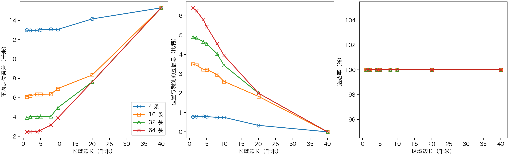
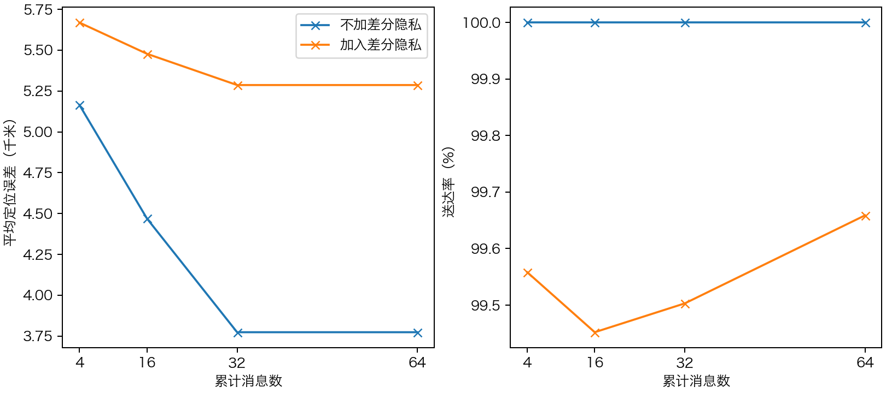

## 5 普通卫星消息的下行调度实验

实验采用 RECORD 的 Iridium 历史星历和公开带噪波束模型[11]，分别回放 2022 年 2 月 14 日 UTC 06:00、12:00 和 18:00 起的三个窗口。地面网格中心为北纬 50.9°、东经 6.95°。每个窗口安排 64 条消息，间隔 16 秒；调度器在最多 10 秒内选择首个覆盖目标区域的单一波束。两个固定接收点记录可见的发送时刻、卫星、波束与静默。终端位置、业务到达和调度决策均由仿真给定。公开波束模型经过扰动，结果属于历史轨道仿真。

### 5.1 固定区域大小对照

在同一 40 × 40 千米网格上，对 1,600 个等概率静止位置穷举，比较 1、2、4、5、8、10、20、40 千米八种区域边长。观察者知道调度规则，以整段观测相同的候选位置中心作为估计。图中定位误差、互信息和送达率均为三个窗口等权平均。

图 5-1　历史卫星覆盖下的区域大小与定位误差。累计 64 条时，1、10、40 千米区域的平均定位误差分别为 2.48、3.90、15.30 千米。10 千米区域在三个窗口中分别为 4.08、3.81、3.81 千米。在这些窗口里，上述三种边长的送达率均为 100%，至少 95% 的已送达消息在到达时隙内发送。当前样本说明区域扩大可以增加定位误差，尚不能确定业务拥塞或弱覆盖时的送达代价。

### 5.2 加入差分隐私前后的定位误差与送达率

两组采用相同的历史轨道窗口、两个相邻的 10 × 10 千米服务区、1,000 个静止终端样本和相同的消息到达时刻。基线组按终端真实所在的区域调度。差分隐私组按终端到两个区域中心的距离随机选择一次服务区域（参数为 0.3/千米），在整个观测窗口内使用该区域调度。两组使用相同的波束选择规则和等待期限。

图 5-2　累计观测 4、16、32、64 条消息后的平均定位误差与消息送达率，均取三个历史轨道窗口的等权平均。定位误差越大，表示观察者推测的位置平均离真实位置越远。

累计 64 条消息后，加入差分隐私使平均定位误差从 3.77 千米增至 5.29 千米，增加约 1.51 千米（40.1%）；消息送达率从 100.00% 降至 99.66%，降低约 0.34 个百分点。该结果适用于本实验的静止终端和三个历史窗口，观测仅包括下行波束、发送时刻及静默。

[GitHub 项目](https://github.com/keyuwa/LocSatPriv) · [历史轨道实验入口](../historical_windows.py) · [固定区域逐窗口结果](../historical-window-results/region-size.csv) · [差分隐私数据与输入文件摘要](../historical-window-results/summary.json)

